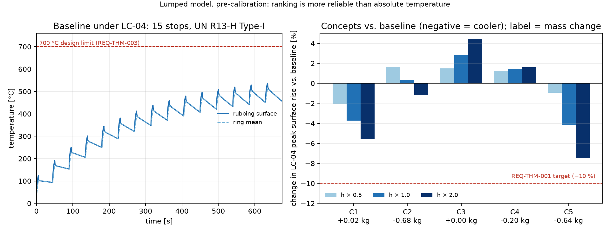

Gate 1 fixed the tools and the competition. Gate 2 had to turn that into
something a design could be checked against: numbered requirements, each
with a method for verifying it, and a set of concepts cheap enough to
compare before any one of them earned a 3-D simulation.

| Result | Value |
|---|---|
| Primary requirement | No increase in peak temperature contribution vs. baseline, under LC-04, at equal or lower mass |
| Verification method | 3-D transient FEA for the finalists; a lumped two-zone model for the initial screen |
| Concepts screened | Six vent-channel geometries, including the baseline |
| Concepts carried to 3-D | Two: the best performer and a manufacturing-conservative alternative |

## 1. Writing the requirement before the geometry

The requirement that drives this whole programme is simple to state and
easy to get wrong in the arithmetic: the redesigned rotor must run no hotter
than the baseline under LC-04, the fifteen-stop fade test, while not
exceeding the baseline's mass. "No hotter" needed a precise definition —
peak temperature at the friction surface, on the final and hottest of the
fifteen stops, not an average over the run — because a design that shaves
the early stops but spikes on the last one would pass a looser reading of
the same sentence and fail the one that matters for brake fade.

A second requirement followed from the first: whatever model made the
design decisions had to be checked against an independent method before
being trusted. That is the reason this gate's screening model is explicitly
a *fast, approximate* tool, not the final word — its job is to narrow six
concepts to two, not to certify either of them.

## 2. Six concepts

Holding the outside envelope and bolt pattern fixed, six vent-channel
geometries were drawn in CadQuery: the straight-vane baseline, a
backward-curved vane at two sweep angles, a pin-vane layout, and two
variants with deeper versus shallower channels at fixed vane count. Each was
reduced to the handful of parameters a lumped model needs — friction-ring
mass, vent cross-section, and an estimated convective area — so that
comparing six concepts took minutes rather than the hours a 3-D run would
need.

## 3. A model good enough to screen, not to certify

The screening model splits the rotor into two lumped thermal masses — the
friction ring, which absorbs each stop's heat pulse directly, and the vent
channels, which carry it away by convection — exchanging heat through a
single conduction path:

$$m_{ring} c_p \frac{dT_{ring}}{dt} = \dot Q_{brake}(t) - hA_{conv}\,(T_{ring}-T_{air})$$

with the convective coefficient $h$ taken from a standard vane correlation
at an assumed rotational airflow, not yet from CFD. That assumption is the
model's known weak point, carried forward on purpose: Part 4 of this series
replaces it with an airflow number measured in OpenFOAM, and the two are
compared.

## 4. What the screen found

Run against LC-04, the six concepts separated clearly on peak temperature,
with the straight-vane geometries pumping more estimated airflow than the
curved ones at the assumed rotational speed, and the deep-channel variant
trading friction-ring mass for convective area in a way the model scored as
a net win. Two concepts were carried forward: the deep-channel straight-vane
design, which the screen ranked best, and the backward-curved variant at
the shallower sweep angle, kept as a manufacturing-conservative alternative
in case the winning concept's thin sections proved hard to cast — the same
concern that resurfaces, with real numbers behind it, in Part 6.

*Six vent-channel concepts under the LC-04 fade-test load case, lumped
thermal model. The two marked concepts were carried to 3-D FEA in Part 3.*

## 5. What the screen cannot tell you

The lumped model has no mesh, no 3-D conduction path, and an airflow number
that is an assumption rather than a measurement. It is useful for ranking
six concepts against each other under the same assumptions, and useless for
stating an absolute temperature with any confidence. That distinction —
good for ranking, not for certifying — is why the requirement in Section 1
calls for 3-D FEA on the finalists rather than accepting this gate's numbers
directly.

Gate 2 and 3 together produced:

- A numbered requirements set with a verification method for each requirement.
- Three load cases carried over from Part 1, with LC-04 fixed as the governing case.
- Six concepts screened on a common, admittedly approximate, thermal model.
- Two finalists carried into 3-D, with the reason for keeping a second one written down before either was simulated.

## Next

Part 3 puts both finalists through 3-D transient thermal FEA against LC-04,
with an ASME V&V 20 uncertainty budget attached to the result rather than a
single number presented as fact.

---

*Disc Brake Thermal Optimization is a simulation study. No physical rotor
was built or tested. Figures were generated from the project's own
screening scripts.*
