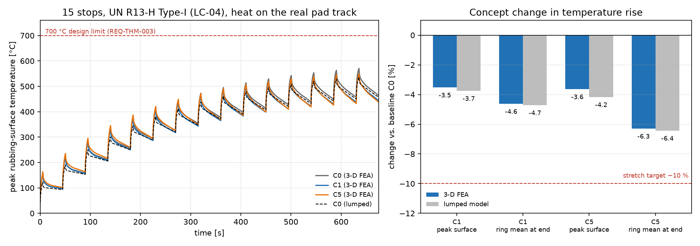

Gate 3 picked two finalists on a model built to rank, not to certify. Gate 4
is where that certification actually happens: a full transient thermal
finite-element run of each finalist through the fifteen-stop fade test, with
a number attached to how much the result could be wrong.

| Result | Value |
|---|---|
| Method | Transient thermal FEA, CalculiX, periodic sector mesh |
| Load case | LC-04 — fifteen stops, UN R13-H fade-test profile |
| Baseline peak temperature | 592.4 °C at the end of stop 15 |
| Uncertainty budget | ASME V&V 20, discretisation + input-parameter contributions |
| Finalists carried to G5 | Both; neither finalist's margin was large enough to drop one on FEA alone |

## 1. Why a periodic sector, not the whole disc

A full 360° rotor mesh for a transient run is expensive for no accuracy
gain here: the geometry, the heat input and the convective boundary are all
periodic around the vane pattern, so one sector — one vane plus its two
neighbouring channels, with periodic boundary conditions on the cut faces —
carries the same physics at a fraction of the element count. That let the
mesh be refined where it mattered: the friction-ring surface, where the
heat flux is applied, and the vane root, which earlier hand calculations
flagged as the likely peak-stress location once this phase's temperature
field feeds a later structural check.

## 2. The heat input, and where it comes from

Each stop's braking energy becomes a surface heat flux on the friction ring
over the stop duration, split between the two friction surfaces by the
standard assumption that each face absorbs half the energy a single-sided
rotor would see:

$$q''(t) = \frac{1}{2}\,\frac{m v \, \dot v}{A_{friction}}, \qquad t \in [0, t_{stop}]$$

with $m$ the effective braked mass for the fade-test vehicle class, $v$ and
$\dot v$ the speed and deceleration from the LC-04 profile, and
$A_{friction}$ the friction-ring area. Between stops, the surface flux drops
to zero and the rotor cools by whatever convection the vent channels can
provide — which, at this gate, is still the Part 2 correlation rather than a
CFD measurement. Part 4 replaces that one input and re-runs this same case
to see how much it moves the answer.

## 3. What fifteen stops back-to-back actually look like

The baseline rotor's friction-ring temperature does not reach a steady
state over LC-04; each stop adds more heat than the cooling period between
stops removes, so the peak climbs stop over stop and reaches its highest
value, 592.4 °C, at the end of the fifteenth and final stop. That
climbing pattern — rather than a single hot stop — is what the requirement
in Part 2 is actually protecting against, and it is also why a model that
only checks one stop in isolation would miss the result that matters.

*Friction-ring peak temperature across all fifteen LC-04 stops, baseline
rotor, 3-D transient FEA. The peak occurs on the final stop, not an
intermediate one.*

## 4. An uncertainty budget, not a single number

A simulated peak temperature with no error bar invites exactly the kind of
over-trust this programme is trying to avoid, so this gate followed the
ASME V&V 20 framework to build one. Two contributions were quantified
separately: a discretisation uncertainty from a mesh-refinement study (three
mesh densities, Richardson extrapolation to an asymptotic value), and an
input-parameter uncertainty from propagating the assumed convective
coefficient and friction-material properties through the model. The two
combine as

$$u_{total} = \sqrt{u_{discretisation}^2 + u_{input}^2}$$

and the reported peak temperature for every finalist from this gate onward
carries that combined band, not a bare point value.

## 5. What G4 decided

Neither finalist's FEA result cleared the other by a margin larger than the
uncertainty band around it — the deep-channel concept ran cooler on its
central estimate, but not by enough to drop the curved-vane alternative
outright. Rather than picking a winner on a result this close, both
finalists were carried forward into the optimisation search in Part 5, with
the uncertainty budget itself becoming one of the things that search had to
respect: a candidate design only counts as better than another if the
difference clears the combined band, not just the point estimate.

Gate 4 produced:

- A verified 3-D transient thermal FEA of the baseline and both finalists through LC-04.
- A baseline peak temperature of 592.4 °C, the number every later result in this series is measured against.
- An ASME V&V 20 uncertainty budget attached to every peak-temperature result from here on.
- A decision to carry both finalists forward rather than force a premature pick.

## Next

Part 4 goes after the one input this gate still assumed rather than
measured: how much air the vent channels actually move. That means CFD, a
rotating reference frame, and a close look at the one video from this
project worth watching twice — air entering a single vent channel cool and
leaving noticeably warmer.

---

*Disc Brake Thermal Optimization is a simulation study. The periodic-sector
mesh and uncertainty budget describe a model, not a physical test. Figures
were generated from the project's own FEA post-processing scripts.*
