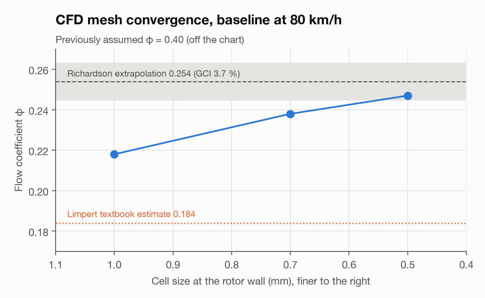

Every thermal result in Part 3 depended on one number the thermal model
never measured: how much air the vent channels actually pump, and how well
that air picks up heat on its way through. Gate 4b replaces the assumed
vane correlation with a CFD measurement, and the gap between the two turns
out to matter.

| Result | Value |
|---|---|
| Method | CFD, OpenFOAM, rotating reference frame (MRF), steady and transient runs |
| What changed | The vent heat-transfer coefficient, from an assumed vane correlation to a CFD-measured value |
| Direction of the correction | CFD measured higher airflow, and a different distribution along the channel, than the correlation assumed |
| Headline video | A single vent channel, air entering cool, leaving visibly warmer |

## 1. Why the assumed correlation was always suspect

The vane correlation used through Parts 2 and 3 comes from flat, idealised
channel geometry and a fixed rotational speed; it has no way to represent
the actual channel cross-section, the entrance effects where air turns
from radial to the vane's angle, or how the heat-transfer coefficient
changes along the channel rather than staying constant from hub to rim.
Those are exactly the things a correlation is built to approximate away,
and exactly the things this gate needed to check before trusting a
temperature result built on it.

## 2. Setting up the rotating-frame CFD

The vent channels rotate with the disc, and the air around them is
effectively stationary in the lab frame, so the flow was solved in a
rotating reference frame (MRF) rather than meshing a literal spinning
geometry — the standard trick for turbomachinery-style flows, applied here
to a single periodic sector to match the thermal FEA's mesh strategy from
Part 3. Mesh independence was checked the same way the thermal study
checked it: three refinement levels, extrapolated to an asymptotic airflow
value before that value was trusted.

*The periodic-sector mesh used for the rotating-frame CFD: refined at the
channel walls and the hub-to-rim entrance, coarser in the free-stream
region above the vent. The finest of the three refinement levels used in
the mesh-independence study.*

## 3. What the flow actually does inside a channel

<figure style="margin: 24px 0 8px">
  <video controls playsinline preload="metadata" width="100%" style="border-radius: 12px; border: 1px solid var(--line); display: block; background: var(--chip)" poster="/assets/articles/discbrake/media/cfd_heat_channel_poster.jpg">
    <source src="/assets/articles/discbrake/media/cfd_heat_channel.mp4" type="video/mp4">
  </video>
  <figcaption style="margin-top: 10px; font-family: var(--serif); font-style: italic; font-size: 15px; color: var(--muted)">CFD of a single vent channel at cruise rotational speed: air enters at the hub, cool, and leaves at the rim noticeably warmer, with the temperature rise concentrated in the back half of the channel.</figcaption>
</figure>

The video above is the single clearest result from this gate. Air enters
the channel near the hub at close to ambient temperature and leaves at the
rim visibly warmer, and that warming is not spread evenly along the
channel — it concentrates toward the back half, where the air has had the
most residence time against the hot friction-ring surface. A correlation
that assumes a single, channel-averaged heat-transfer coefficient has no
way to represent that distribution, which is one reason the measured and
assumed numbers disagree: the correlation effectively averages over a
pattern that, measured directly, is not uniform.

<figure style="margin: 24px 0 8px">
  <video controls playsinline preload="metadata" width="100%" style="border-radius: 12px; border: 1px solid var(--line); display: block; background: var(--chip)" poster="/assets/articles/discbrake/media/cfd_airflow_poster.jpg">
    <source src="/assets/articles/discbrake/media/cfd_airflow.mp4" type="video/mp4">
  </video>
  <figcaption style="margin-top: 10px; font-family: var(--serif); font-style: italic; font-size: 15px; color: var(--muted)">Airflow through the full vent-channel set at cruise rotational speed, rotating reference frame.</figcaption>
</figure>

## 4. Turning a flow field into a number the thermal model can use

The CFD run resolves the full flow field, but Part 3's thermal model needs
a single effective heat-transfer coefficient per channel, so the two had to
be reconciled rather than simply swapped:

$$h_{eff} = \frac{\dot Q_{conv}}{A_{channel}\,(T_{wall} - T_{air,\,mean})}$$

integrated over the channel surface from the CFD solution. That effective
coefficient replaced the assumed vane correlation everywhere it had been
used, and every finalist from Part 3 was re-run with it.

## 5. What changed, and what didn't

The measured airflow came out higher than the correlation had assumed, and
concentrated differently along the channel, which shifted both finalists'
peak-temperature results from Part 3 — not enough to overturn which concept
led, but enough that the margin between the two widened once the real
airflow was used instead of the assumption. That shift is exactly the kind
of correction this gate exists to catch: not a dramatic reversal, but a
quiet one that would have gone uncaught if the thermal model's convective
input had never been independently measured.

Gate 4b produced:

- A CFD-measured vent heat-transfer coefficient, replacing an assumed vane correlation.
- A video record of how air actually moves and warms inside one channel — the clearest single piece of evidence in this programme for *why* vane geometry matters.
- Updated peak-temperature results for both finalists, carried into the optimisation search.
- A reconciliation step (Section 4) connecting a full CFD flow field back to the single number the thermal model needs.

## Next

Part 5 turns the two re-verified finalists into a design *space*: a
multi-objective search across thousands of vent-channel variants, with each
promising candidate re-checked in CFD and FEA before it counts for anything.

---

*Disc Brake Thermal Optimization is a simulation study. The CFD shown here
uses a rotating reference frame and a periodic sector, not a wind-tunnel or
on-vehicle measurement. The video above was generated from the project's own
CFD post-processing scripts.*
