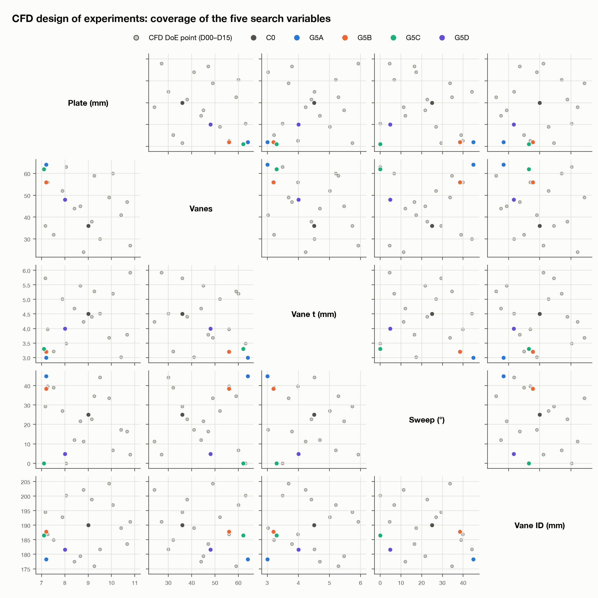
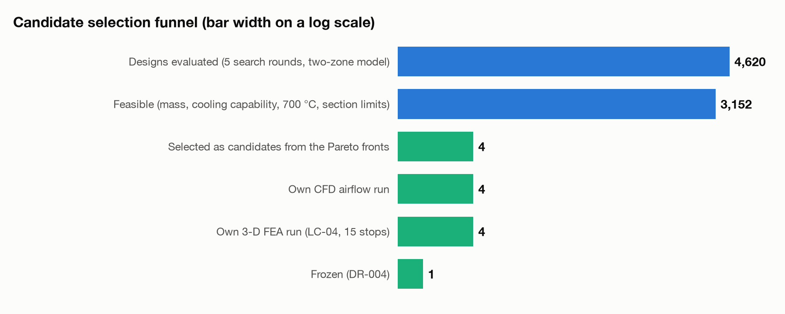

Parts 3 and 4 verified two finalists by hand. Gate 5 stopped comparing a
handful of concepts and searched a space of thousands instead — and spent
most of its five rounds finding out how an optimiser cheats before it spent
any time finding the actual answer.

| Result | Value |
|---|---|
| Method | NSGA-II multi-objective search, calibrated two-zone thermal model, CFD-based airflow regression |
| Designs searched | ∼4,600 across five rounds |
| Objectives | Minimise LC-04 peak temperature; minimise mass; neither worse than the baseline |
| Model gaps found by the optimiser | Three, closed one round at a time |
| Frozen design | G5C: −8.2% peak temperature, 0.92 kg lighter than baseline, re-verified in CFD and 3-D FEA |
| Fallback | G5D: wider vent channels, roughly half the gain, kept in case G5C proves not castable |

## 1. Why a search needs its own fast model

Running 3-D FEA and CFD on every candidate an optimiser proposes is not
affordable — a search that tries thousands of designs needs something it
can evaluate in milliseconds, not minutes. Part 2's two-zone thermal model
was recalibrated against the Part 4 CFD data — the measured airflow and
heat-transfer distribution, not the original assumed correlation — and an
airflow regression was fit across the geometry parameters so the search
model could estimate, for any vent-channel shape, roughly what CFD would
have measured without actually running it.

That calibrated model is explicitly a proxy, not a certified result. Every
design the search finds promising still has to be re-verified the slow way
before it counts for anything, which is exactly what caught the three
problems below.

## 2. What NSGA-II is actually doing

The search optimises two objectives at once — peak temperature and mass —
rather than collapsing them into one score, because the right trade-off
between the two is a decision this project wanted to see and make
explicitly, not one buried inside a weighting the optimiser chose on its
own. NSGA-II works by evolving a population of designs toward the Pareto
front: the set of designs where no objective can be improved without making
the other worse,

$$\text{design } x \text{ dominates } y \iff T_{peak}(x) \le T_{peak}(y)\ \text{and}\ m(x) \le m(y),\ \text{with at least one strict}$$

keeping the non-dominated front each generation and discarding designs a
better one already beats on both counts.

## 3. Three rounds of finding out the model was wrong

- **Round 1** converged on a design whose airflow estimate came entirely
  from extrapolating the regression well outside the CFD data it was fit
  on — the search had found a region the fast model trusted and the real
  physics did not.
- **Round 2** converged on a design where the fitted heat-transfer
  coefficient went unphysically high for a very narrow channel — the
  regression had no term bounding it, so the optimiser pushed straight
  through the edge of what the model could honestly represent.
- **Round 3** converged on vent channels 3.2 mm wide: thermally excellent in
  the model, and narrower than any foundry this project checked would cast
  in grey iron. Nothing in the model itself knew that; the only thing that
  caught it was checking the optimum against a manufacturing rule that had
  not yet been written into the search.

Each gap was closed before the next round ran — a hard floor under the
regression's trusted range, a cap on the fitted coefficient, and a minimum
castable section width, respectively. None of the three was found by the
search; all three were found by checking its answer against something
outside it, the same principle Parts 3 and 4 applied to simulation results
and this round applied to the search itself.

## 4. Round 4, and the design that held

With all three constraints in place, Round 4's Pareto front stopped moving
in a way the earlier rounds' fronts had not: the best trade-offs it found
were consistent with Round 5's independent re-sampling of the same region,
rather than drifting toward whatever edge of the model happened to still be
unconstrained. The design chosen from that front, re-verified with its own
CFD and 3-D FEA run rather than taken on the search model's word, is G5C.

*Peak LC-04 temperature against mass for designs sampled across all five
rounds. Later rounds concentrate near the constrained Pareto front; the
three excluded regions correspond to the model gaps in Section 3.*

Seen a different way, the same five rounds are a funnel: roughly 4,600
designs evaluated, narrowing round over round as each model gap in Section
3 closed off a region that had looked promising for the wrong reason, down
to the handful of candidates re-verified in CFD and 3-D FEA, and finally to
the one design frozen in Section 5.

*Designs evaluated per round, narrowing from roughly 4,600 sampled to the
small set re-verified in CFD and 3-D FEA, to the one design frozen as G5C.*

## 5. Freezing two designs, not one

G5C runs 8.2% cooler at peak than the baseline and 0.92 kg lighter, both
numbers re-checked in CFD and 3-D FEA rather than read off the search model.
Its narrowest vent section is 6.2 mm — inside the manufacturing rule added
in Round 3, but close enough to that boundary that it was frozen alongside
a second candidate, G5D, which widens the channels and gives up roughly
half the thermal gain in exchange for a wider manufacturing margin. Which
of the two is the right production choice is not a question this
programme's simulations can answer on their own, and Part 6 says why.

Gate 5 produced:

- A calibrated, CFD-informed thermal model fast enough to search thousands of designs.
- Three model gaps found and closed, each one by checking an optimum against something outside the model that proposed it.
- A frozen design, G5C, re-verified in CFD and 3-D FEA at −8.2% peak temperature and 0.92 kg lighter than baseline.
- A fallback design, G5D, carried alongside it rather than discarded.

## Next

Part 6 looks at what simulation alone cannot settle — castability, the
choice between G5C and G5D, and the load cases this programme has not yet
closed — and sets out what Gate 6 still has to do.

---

*Disc Brake Thermal Optimization is a simulation study. Every design shown
here, including G5C and G5D, exists only as a simulated candidate; no
physical rotor was built or tested. Figures were generated from the
project's own optimisation post-processing scripts.*
