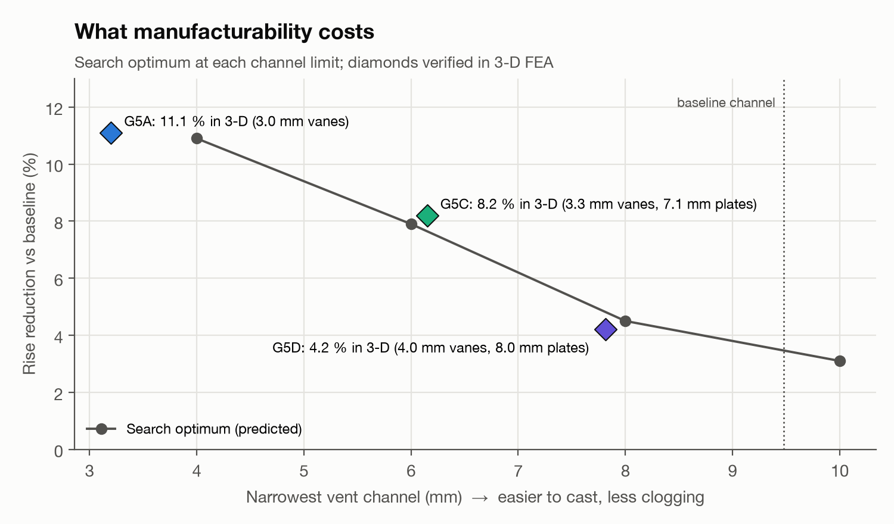

Part 5 froze a design. This part is about the difference between a frozen
design and a finished one — the questions the five previous gates didn't
ask, and the two that are still open with Gate 6 unstarted.

| Result | Value |
|---|---|
| Frozen design | G5C: −8.2% LC-04 peak temperature, 0.92 kg lighter than baseline |
| Fallback | G5D: roughly half the thermal gain, wider vent channels |
| Not yet closed | Wear-limit load case, remaining LC-04-adjacent cases in 3-D, thermal-stress check |
| Not simulated at all | Noise, pumping loss, cost, and the actual foundry decision between G5C and G5D |

## 1. The result, stated plainly

Across fifteen stops of the UN R13-H fade test, the frozen design G5C runs
8.2% cooler at its peak than the baseline rotor and is 0.92 kg lighter,
both numbers verified in 3-D FEA and CFD rather than the search model that
found the candidate. It is not uniformly better, though: G5C's higher
airflow costs it in the early stops, where it actually runs hotter than the
baseline, and the advantage only opens up from around the seventh stop
onward as the baseline's lower airflow struggles to shed heat from the
earlier stops. The summary number — 8.2% cooler — is a peak-to-peak
comparison on the hottest stop; it is not true at every point in the run,
and saying so plainly matters more here than the headline figure does.

<figure style="margin: 24px 0 8px">
  <video controls playsinline preload="metadata" width="100%" style="border-radius: 12px; border: 1px solid var(--line); display: block; background: var(--chip)" poster="/assets/articles/discbrake/media/cfd_compare_c0_g5c_poster.jpg">
    <source src="/assets/articles/discbrake/media/cfd_compare_c0_g5c.mp4" type="video/mp4">
  </video>
  <figcaption style="margin-top: 10px; font-family: var(--serif); font-style: italic; font-size: 15px; color: var(--muted)">Vent airflow, baseline (left) vs. the frozen design G5C (right), same load case and colour scale.</figcaption>
</figure>

## 2. Why a mass number alone isn't the whole story

0.92 kg sounds like a clean win, and the FEA and CFD numbers behind it are
real, but mass alone says nothing about where the metal was removed from or
whether that section survives everything a rotor actually sees in service.
A thinner vane or channel wall that helps the thermal result can hurt
stiffness, fatigue life under thermal cycling, or simple castability — none
of which this programme's thermal and flow models were built to check.
Treating "lighter and cooler" as the end of the story would be the same
mistake the optimiser kept making in Part 5, just one level up: trusting a
model for something it was never asked to represent.

## 3. The manufacturability question the search couldn't answer

Round 3 of the optimisation search (Part 5) added a minimum castable
section width after the search converged on channels no foundry this
project checked would actually cast. That rule — 6 mm, this project's own
conservative assumption rather than a published standard, since no single
public minimum-section figure for a grey-iron brake disc was found — is
what separates G5C from its fallback. G5C's narrowest channel sits at
6.2 mm, just inside that line; G5D widens the channels well past it, at
the cost of roughly half the thermal gain.

*Thermal performance against minimum vent-channel section width, for the
frozen design and its fallback. The 6 mm line is this project's own
conservative assumption, not a verified foundry limit.*

That is a decision a foundry review settles, not a simulation. This project
does not have that review, so the honest status is: two frozen candidates,
a documented reason for keeping both, and an open decision between them
that depends on information outside what CAD, FEA and CFD can provide.

## 4. What Gate 6 still has to do

Three things are explicitly still open, and are not glossed over here:

- **The wear-limit case.** LC-04 is the fade test, run on a rotor at nominal
  thickness. A worn rotor, closer to its minimum legal thickness, has less
  thermal mass and a different result — not yet simulated for either
  frozen design.
- **The remaining load cases in 3-D.** WLTC and NEDC were used to shape the
  requirements in Part 2, but have not been run through the same 3-D FEA
  and CFD pipeline the fade test received.
- **A thermal-stress check.** Every result in this series is a temperature
  field. None of it has yet been carried into a structural analysis of the
  stresses that temperature field actually produces, which is the step a
  real OEM programme would not skip before calling a design final.

## 5. What this project actually demonstrates

Not a production-ready brake rotor — the open items above rule that out on
their own. What it demonstrates is that a six-gate, requirement-first
engineering process, run with an AI coding agent writing the implementation
and a human owning the requirements and the gate decisions, can produce a
result that survives its own verification plan: a search that got caught
gaming its model three times before the real answer held, a design frozen
with a documented, still-open trade-off rather than a false sense of
closure, and every number in this series traceable back to the script that
produced it.

Gate 6, when it runs, inherits exactly the open list above — nothing more,
nothing quietly dropped.

---

*Disc Brake Thermal Optimization is a simulation study. G5C and G5D are
simulated candidates; neither has been built, tested, or reviewed by a
foundry. The full technical report, including every gate's verification
detail, is available as a downloadable PDF from the [project page]({{ "/projects/discbrake/" | relative_url }}).*
